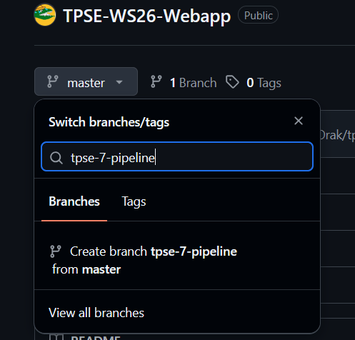
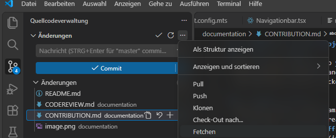
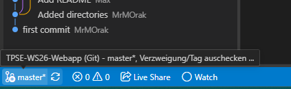
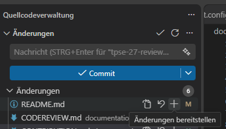
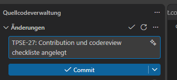

# To contribute to this project follow these steps:
 
## 1. Jira and tickets
 
- have a ticket assigned to you on the [jira board](https://tpsetuda.atlassian.net/jira/software/projects/TPSE/list?)
- understand the workload and ask questions if necessary
- set the status of the ticket to "In Progress"
## 2. Creating a branch
 
- branches follow this naming scheme **tpse-_ticketnumber_-short-description** e.g. tpse-7-pipeline
- to ease the use of git create a remote branch first
- **make sure you branch off of the master branch**

 
## 3. Working locally

### 3.1 Implementation 

1. Fetch all remote branches:
   `git fetch`

   

2. Switch to your feature branch:
   `git checkout tpse-7-pipeline`

   

3. Implement the feature and the mandatory tests.

### 3.2 Testing 

1. Run the appropriate tests for your implementation
    - for frontend implementations use `npm run test` and `npm run test:coverage` 
    - for backend implementations use `pytest` and `pytest --cov`
2. Make sure no test fails. They are used to prevent regression. If your implementation caused an existing test to fail, change the implementation **not the test**, when in doubt ask the creator of the test for advice or work together to find a solution (e.g. pair programming) 
3. Also make sure the test coverage is >=70% else the CI tests will fail and the implementation cannot be merged

### 3.3 Checking in the implementation

1. Check which files changed:
   `git status`
2. Stage your changes:
   `git add "filename"`

   

3. Commit with the ticket number (in capital letters) and a short description of the changes:
   `git commit -m "TPSE-7: added pipeline for frontend and backend testing"`
   
   

4. Update your branch with the latest master:
   `git pull origin master`
   - If Git reports merge conflicts: open the affected files, resolve the conflict markers
     (`<<<<<<<`, `=======`, `>>>>>>>`), then run `git add "filename"` and `git commit`.
5. Push to the remote feature branch:
   `git push`
6. Ask for a [pull request](CODEREVIEW.md) to add the implemented feature to the master branch and change the ticket status to "In Review".
